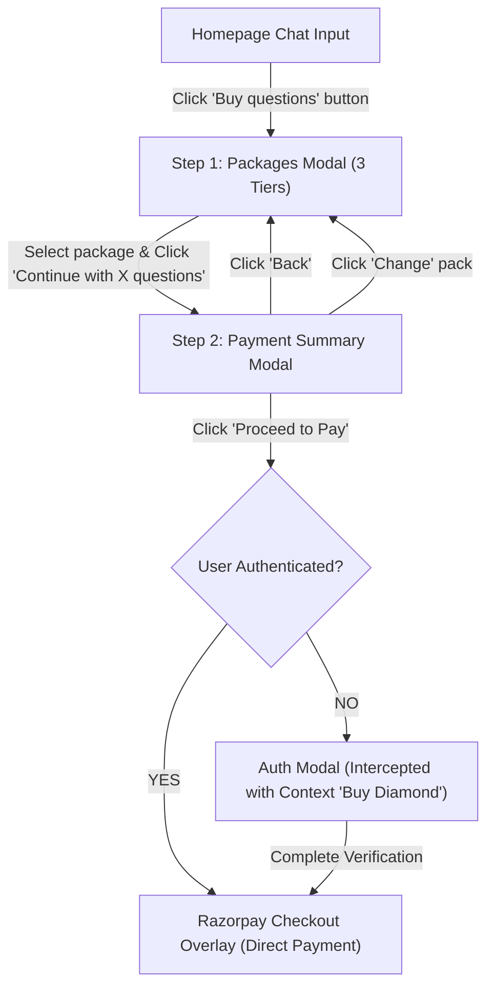

# Melooha "Buy Questions" Flow & Architecture Reference

> **Source Domain:** [https://www.melooha.com/](https://www.melooha.com/)  
> **Captured Via:** Playwright MCP Inspection  
> **Date:** October 2026  
> **Visual Artifacts:**  
> - Step 0 (Home): [`buy-questions-step0-home.png`](./buy-questions-step0-home.png)  
> - Step 1 (Packages Popup): [`buy-questions-step1-packages.png`](./buy-questions-step1-packages.png)  
> - Step 2 (Payment Summary): [`buy-questions-step2-payment-summary.png`](./buy-questions-step2-payment-summary.png)  
> - Step 3 (Auth Interception): [`buy-questions-step3-auth-flow.png`](./buy-questions-step3-auth-flow.png)  

---

## 1. Flow Overview & State Machine

---

## 2. Step-by-Step Breakdown

### Step 0: Homepage Entrypoint
- **Trigger Element:** `<button>Buy questions</button>` located in the right action group of the hero query card (adjacent to the Send button).
- **Styling:** Pill button with subtle border, uppercase label, placed within the Obsidian-glass chat input container.

---

### Step 1: Packages Selection Modal (`Buy more questions`)
- **Dialog Title:** `Buy more questions`
- **Subtitle:** `One-time purchase · never expires · every answer stays chart-bound.`
- **Header Actions:** Close (`×`) button.
- **Packages Table (Radiogroup):**

| Tier Name | Badge | Question Count | Offer Price | Original Strikethrough | Unit Price | Promo Tag | Pre-selected? |
| :--- | :--- | :---: | :---: | :---: | :---: | :---: | :---: |
| **Silver** | — | 7 questions | ₹664 | ₹1,399 | ₹95 per question | Code `PAYNOW` | No |
| **Gold** | `Popular` | 12 questions | ₹799 | ₹2,399 | ₹67 per question | Code `GOLDNOW` | No |
| **Diamond** | `Best Value` | 20 questions | ₹1,139 | ₹3,999 | ₹57 per question | Code `PAYNOW` | **Yes (Default)** |

- **Footer Information:**
  - Trust reassurance: `Secure payment · GST invoice · Instant credit`
  - Sticky Action Button: `Continue with {N} questions · ₹{Amount}` (e.g., `Continue with 20 questions · ₹1,139`).

---

### Step 2: Payment Summary Modal (`Payment summary`)
- **Dialog Header:**
  - `← Back` button (returns to Step 1 Packages).
  - Indicator: `Step 2 of 2`.
  - Title: `Payment summary`.
  - Close (`×`) button.
- **Section 1: Pack Selection Review:**
  - Title: `Your pack` + `Change` button (returns to Step 1).
  - Display: `{Tier Name} · {N} questions` (e.g., `Diamond · 20 questions`).
  - Subtitle: `Never expires · added to your account instantly`.
- **Section 2: Billing State Selection:**
  - Title: `Billing state`.
  - Subtitle: `Required on your GST invoice`.
  - Dropdown: `<button>Billing state: Maharashtra</button>`.
- **Section 3: Promo Code:**
  - Header: `Promo code` + `View all coupons` button.
  - Applied Chip: `{COUPON_CODE} Applied` + `Remove promo code` button (e.g., `PAYNOW Applied`).
- **Section 4: Order Cost Breakdown:**
  - Base Package Price: `20 Questions` → `₹3,999`
  - Discount Line: `PAYNOW discount` → `− ₹2,860`
  - Taxes Line: `Taxes and fees` → `Included`
  - Total Line: `Total (GST included)` → `₹1,139`
- **CTA:** `<button>Proceed to Pay</button>`
- **Trust Badge:** `Razorpay secured` with security lock glyph.

---

### Step 3: Auth Interception (`Log in to Melooha`)
When the visitor clicks **"Proceed to Pay"** without an active session:
1. The payment modal closes/yields and immediately prompts the **Auth & Chart Binding Modal**.
2. **Contextual Awareness:**
   - The left hero column adapts its headline to the exact purchase intent:  
     `"This needs your birth chart — “Buy Diamond”"`
   - Bullet items emphasize chart binding value:
     - `Readings saved to your chart, not a cookie`
     - `Vaani remembers every thread`
     - `Astropedia stays free`
3. **Step 1 of 4 Auth Form:**
   - `YOUR NUMBER · STEP 1 OF 4`
   - Heading: `What's your number?`
   - Description: `We'll text a code to verify it. Your chart and readings stay tied to this number.`
   - Phone Input: Country code selector (`+91`) + Mobile number.
   - Continue Button: Disabled until a valid number is supplied.
   - Note: `WE ONLY USE YOUR NUMBER TO SIGN YOU IN`.
4. **Post-Auth Flow:** Once OTP is verified and the user profile is established, the application directly triggers the Razorpay Checkout gateway overlay (`razorpay.js` / standard iframe) using the order ID and amount from Step 2.
